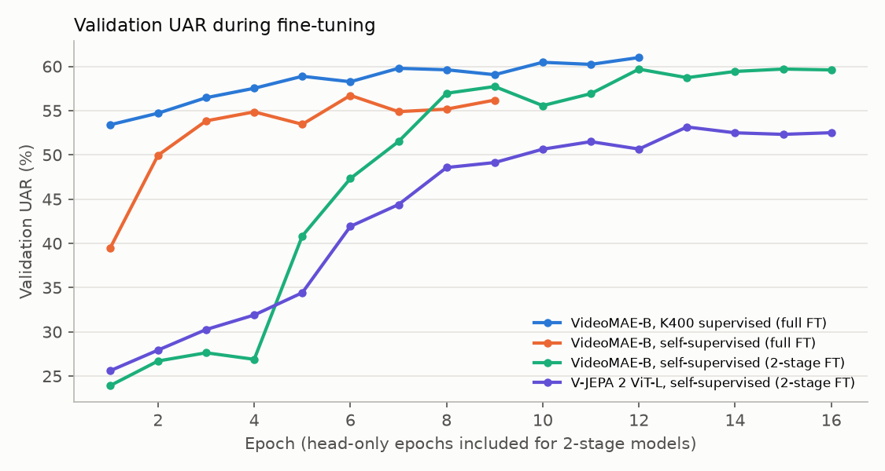
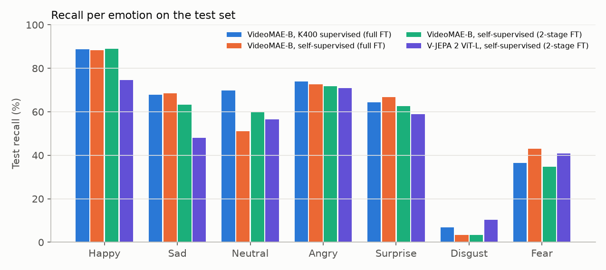
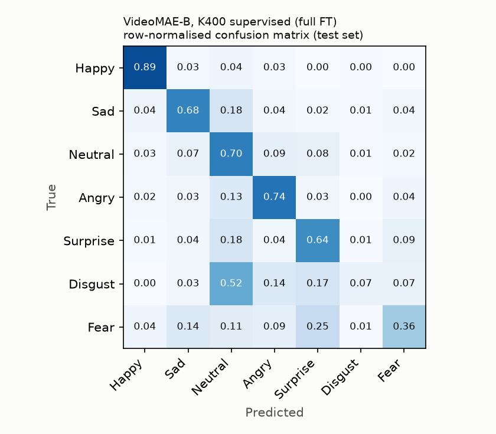

# Facial Emotion Recognition in Videos with Self-Supervised Video Transformers


Does **self-supervised video pre-training** help recognise emotions in real-world video clips? This project fine-tunes and compares four video transformers on **DFEW** (Dynamic Facial Expression in-the-Wild): 16,372 movie clips labelled with 7 emotions (happy, sad, neutral, angry, surprise, disgust, fear). All models are fine-tuned under the same protocol. The models are also tested on new real-world videos, to see how they behave outside the dataset.

Group project by **Youssef Khazal** and [**Melissa Fahed**](https://github.com/Githubmelissa) (M.Sc. Data Science & AI, Université Côte d'Azur, 2026).

---

## Models compared

| Model | Pre-training | Fine-tuning | Params |
|---|---|---|---|
| **VideoMAE-B, K400 supervised** | Self-supervised masked video modelling, then supervised action classification on Kinetics-400 | full | 86M |
| **VideoMAE-B, self-supervised** | Self-supervised masked video modelling only (Kinetics-400 videos, no labels) | full | 86M |
| **VideoMAE-B, self-supervised, 2-stage** | same as above | head only, then head + last 2 blocks | 86M |
| **V-JEPA 2 ViT-L** | Self-supervised latent prediction (V-JEPA 2) | head only, then head + last 2 blocks | 375M |

All checkpoints come from the Hugging Face Hub (`MCG-NJU/videomae-base-finetuned-kinetics`, `MCG-NJU/videomae-base`, `facebook/vjepa2-vitl-fpc64-256`).

---

## Results (DFEW fold 1)

**Best model: VideoMAE-B pre-trained on Kinetics-400 (self-supervised, then supervised), 58.3% UAR and 70.2% WAR on the test set** (7 classes; chance: 14.3% UAR).

| Model | Params | Test UAR | Test WAR | Val UAR | Training time |
|---|---|---|---|---|---|
| **VideoMAE-B, K400 supervised** (full FT) | 86M | **58.3%** | **70.2%** | 61.0% | 2.5 h |
| VideoMAE-B, self-supervised (full FT) | 86M | 56.3% | 66.5% | 56.7% | 1.9 h |
| VideoMAE-B, self-supervised (2-stage FT) | 86M | 54.9% | 66.4% | 59.7% | 1.2 h |
| V-JEPA 2 ViT-L, self-supervised (2-stage FT) | 375M | 51.4% | 60.1% | 53.2% | 4.7 h |

**UAR** (unweighted average recall) is the mean recall over the 7 emotions, and is the main metric because DFEW is very imbalanced: disgust has 116 training clips, happy 1,956. **WAR** is plain accuracy. Numbers come from `runs/*/metrics.json` and are rebuilt with `python -m dfer.report`.





**Observations**
- **Supervised video pre-training on top of self-supervision helps.** The same VideoMAE-B backbone does better when it was also trained on Kinetics-400 action labels: +2.0 points UAR and +3.7 points WAR over the self-supervised-only checkpoint, and it starts from a much better point (53% validation UAR after one epoch, vs 39%).
- **Full fine-tuning beats 2-stage fine-tuning, but costs more.** For the self-supervised VideoMAE, updating every layer gives +1.4 points UAR over training only the head and the last 2 blocks, for about 1.6x the training time.
- **The largest model is last.** V-JEPA 2 ViT-L (4x more parameters) reaches 51.4% UAR. With only its last 2 of 24 blocks updated, and clips of 16 frames at 224x224 instead of the 64 frames at 256x256 it was pre-trained on, its features transfer less well to faces under this budget. Its validation UAR levelled off around 52-53% in the last epochs; unfreezing more blocks or using longer clips might help, at a much higher cost (it was already the slowest model).
- **Rare emotions are the hard part.** Every model recognises happy (75-89%) and angry (71-74%) well, but disgust almost never (3-10%; most disgust clips are predicted as neutral) and fear only 35-43% (often confused with surprise). This is where UAR and accuracy diverge.



---

## Evaluation protocol

- **Split:** official DFEW fold 1 (subject-independent), with 9,356 training clips and 2,341 test clips.
- **Model selection:** a stratified 10% of the *training* clips is held out as validation. Early stopping and the best epoch are chosen on validation UAR. The **test set is used once**, at the very end.
- **Input:** 16 frames per clip (the DFEW time-interpolated version), 224x224, in temporal order. Training augmentation (random resized crop + horizontal flip) is **identical across the frames of a clip**, so motion is preserved.
- **Loss:** cross-entropy with inverse-frequency class weights, AdamW, cosine schedule, mixed precision.
- **Same settings for every model:** up to 12 epochs (2-stage models: 4 head-only epochs first, then up to 12 epochs with the head and last 2 blocks), backbone lr 3e-5, head lr 1e-3 (halved in stage 2), weight decay 0.05, batch 2 with 4 gradient-accumulation steps (effective batch 8), early stopping with patience 3, seed 42. No per-model tuning.
- **Hardware:** a single RTX 4060 laptop GPU (8 GB).

### Implementation details

- **Temporal order:** frame files (`1.jpg … 16.jpg`) are sorted numerically, so clips are always fed in time order (`tests/test_data.py`).
- **No test-set tuning:** early stopping and checkpoint selection use only the validation split taken from the training data.
- **Clip-consistent augmentation:** one random crop and flip is drawn per clip and applied to all 16 frames, so motion between frames is preserved.

---

## Real-world test

`dfer.predict` runs a trained model on any video. It detects the face with OpenCV, crops a padded square on 16 evenly spaced frames, and outputs the probability of each emotion:

```bash
python -m dfer.predict my_video.mp4 --run-dir runs/videomae_k400_fold1_seed42
```

In the original project, on short phone videos of two people acting five emotions, every model showed a strong bias toward *sad* and struggled with *angry* and *surprise*. DFEW comes from movies, so these clips represent a clear domain shift. The personal test videos are not published.

---

## How to run

```bash
git clone https://github.com/youssef-khazal/dfer-video-ssl.git
cd dfer-video-ssl
pip install -r requirements.txt     # install the PyTorch build for your GPU first
pip install -e ".[dev]"

# DFEW must be requested from the authors (https://dfew-dataset.github.io/); research use only.
# Expected layout: <DFEW>/Clip/clip_224x224_16f/<id>/1.jpg ... and <DFEW>/EmoLabel_DataSplit/

python -m dfer.train --dfew-root <DFEW> --model videomae_k400 --fold 1 --amp
python -m dfer.report --runs-dir runs --out-dir results
pytest
```

Models: `videomae_k400`, `videomae_ssl`, `videomae_ssl_2stage`, `vjepa2`. Training can be interrupted and continued with `--resume`.

---

## Repository structure

```
src/dfer/
  data.py      DFEW loading, numeric frame order, clip-consistent augmentation, train/val/test split
  models.py    Hugging Face video backbones behind one interface, freezing for 2-stage fine-tuning
  metrics.py   UAR / WAR
  train.py     fine-tuning with validation-based model selection and a single final test evaluation
  report.py    results tables, validation curves, confusion matrix
  predict.py   face detection + emotion prediction on any video file
tests/         frame order, augmentation, split leakage, model shapes, metrics, end-to-end training
notebooks/     original course-project notebooks (outputs cleared)
```

---

## Limitations

- **One fold.** DFEW results are normally reported as the average over 5 folds; this project uses fold 1 only, due to compute.
- **One seed per model, no hyperparameter tuning.** Every model uses the same settings, which keeps the comparison fair but is not the best possible setting for each model. Differences of 1-2 points may not be significant.
- **Small validation split.** 936 clips; validation and test UAR can differ by several points (e.g. 59.7% vs 54.9% for the 2-stage VideoMAE).
- **Rare classes.** Disgust (116 training clips) and fear are hard for every model; per-class recall is reported for this reason.
- **Real-world test is tiny.** Ten short clips from two people show trends but are not a benchmark.

---

## Authors

**Youssef Khazal** ([GitHub](https://github.com/youssef-khazal) · [LinkedIn](https://www.linkedin.com/in/youssef-khazal)) and **Melissa Fahed** ([GitHub](https://github.com/Githubmelissa)).

Code under the [MIT License](LICENSE). DFEW is © its authors and restricted to non-commercial research. No DFEW data or frames are included in this repository.
